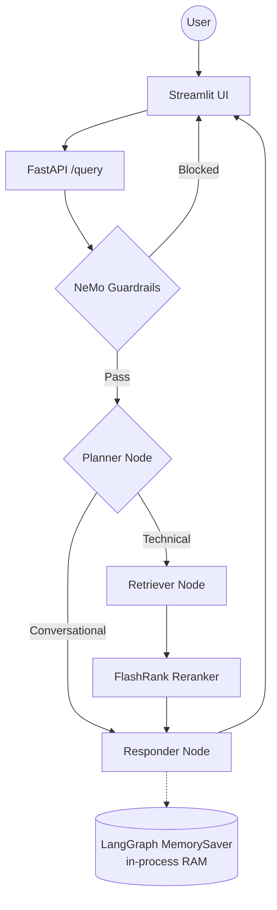
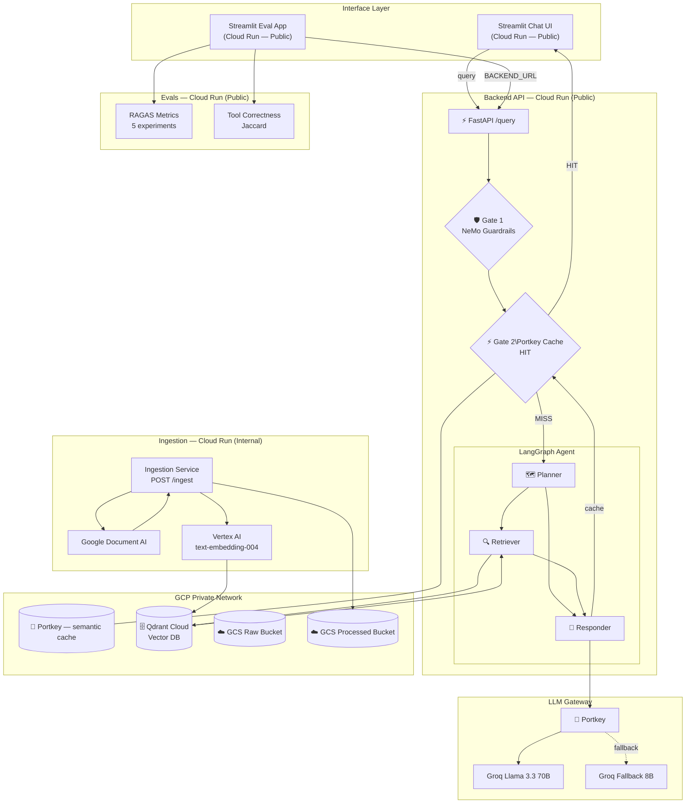

# Enterprise Agentic RAG

A production-grade RAG system built with **LangGraph**, **NeMo Guardrails**, **Portkey LLM Gateway**, **RAGAS Evals**, and **Google Cloud Platform**. Deployed as four independent microservices on Cloud Run, managed entirely with Terraform.

---

## Key Features

- **Agentic Intelligence** — LangGraph cyclic graph: Planner → Retriever → Responder with persistent memory across sessions
- **Two-Gate Safety** — Gate 1: NeMo Guardrails (blocks jailbreak/off-topic); Gate 2: Redis Semantic Cache (serves cached answers in ~50ms)
- **LLM Gateway** — Portkey routes all LLM calls with automatic fallback (Llama 3.3 70B → Llama 3.1 8B), full dashboard visibility
- **Enterprise Search** — Qdrant Cloud vector search + FlashRank local reranker
- **Evaluation Suite** — RAGAS (5 metrics) + Jaccard Tool Correctness. GCS-persisted history. Deployed as its own Cloud Run service.
- **Full Observability** — Pydantic Logfire traces across every agent node and eval run

---

## Architecture

### Monolithic (v1)

The original single-process application — all components in one container, in-memory state, manual ingestion.



### Scalable Enterprise (v2 — current)

Four independent microservices, event-driven ingestion, persistent memory, semantic caching, and full IaC via Terraform.



---

## Project Structure

```text
Directory structure:
└── prodrag_application/
    ├── README.md
    ├── commands_for_gcloud.md
    ├── Dockerfile
    ├── LICENSE
    ├── requirements.txt
    ├── app/
    │   ├── __init__.py
    │   ├── config.py
    │   ├── main.py
    │   ├── agents/
    │   │   ├── graph.py
    │   │   ├── state.py
    │   │   └── nodes/
    │   │       ├── planner.py
    │   │       ├── responder.py
    │   │       └── retriever.py
    │   ├── gateway/
    │   │   ├── __init__.py
    │   │   └── client.py
    │   ├── guardrails/
    │   │   ├── colang_rules.py
    │   │   └── rails.py
    │   ├── ingestion/
    │   │   ├── processor.py
    │   │   ├── chunking/
    │   │   │   ├── __init__.py
    │   │   │   └── splitter.py
    │   │   └── loaders/
    │   │       ├── __init__.py
    │   │       ├── html.py
    │   │       ├── office.py
    │   │       ├── pdf.py
    │   │       └── text.py
    │   └── services/
    │       ├── __init__.py
    │       └── retrieval/
    │           ├── embedding.py
    │           ├── qdrant_service.py
    │           └── ranking_service.py
    ├── evals/
    │   ├── __init__.py
    │   ├── data_parser.py
    │   ├── guardrails_eval.py
    │   ├── metrics.py
    │   ├── og_golden_dataset.json
    │   └── pipeline.py
    ├── notebooks/
    │   └── 03_evals.ipynb
    └── ui/
        └── app.py
```

---

## Tech Stack

| Layer | Technology |
|-------|-----------|
| Agent Orchestration | LangGraph (cyclic graph) |
| LLMs | Groq Llama 3.3 70B + 3.1 8B via **Portkey** gateway |
| Guardrails | NeMo Guardrails (Gate 1) |
| Semantic Cache | Portkey Memorystore + Vertex AI embeddings (Gate 2) |
| Vector DB | Qdrant Cloud |
| Reranking | FlashRank (local, zero-latency) |
| Embeddings | **Vertex AI text-embedding-004** |
| Document Parsing | Google Document AI (PDF OCR) |
| Evaluation | RAGAS (5 metrics) + Jaccard Tool Correctness |
| Observability | Pydantic Logfire + Portkey Dashboard |
| Compute | Google Cloud Run (4 independent microservices) |

---

## Getting Started

### Local development

```bash
python -m venv tenvv
source tenvv/Scripts/activate   # Windows Git Bash
pip install -r requirements.txt
```

Create `.env` — see [DOCS/07_ENVIRONMENT_VARIABLES.md](DOCS/07_ENVIRONMENT_VARIABLES.md) for all required keys.

```bash
# Ingest documents locally
python -m app.ingestion.processor DATA/true_data

# Terminal 1 — backend
uvicorn app.main:app --reload --port 8000

# Terminal 2 — UI
streamlit run ui/app.py

# Terminal 3 — evals (optional)
streamlit run evals/app.py
```

---


*Built for High-Scale Enterprise Document Intelligence.*
